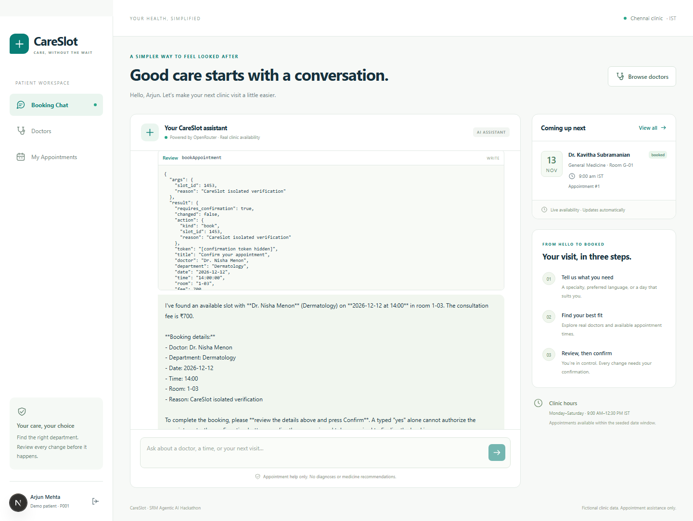
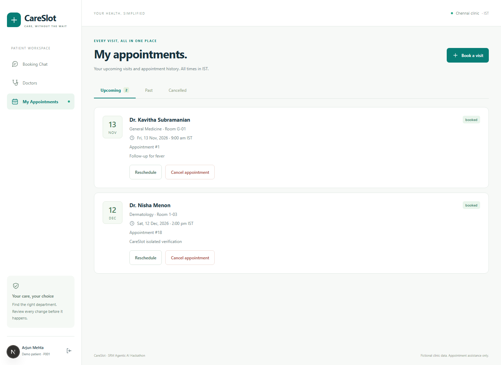

# CareSlot: five-slide presentation content

Exactly five slides, following H12 in the official handbook. The PPTX authoring runtime is unavailable on this host, so this is complete paste-ready content with actual screenshots. Export the assembled deck as PDF or share a view-only Google Slides link, as the official submission requires. Team number/member roles were requested from the owner and have not been supplied; add those verified identities before submitting.

## Slide 1: CareSlot

- PS3 Clinic Appointment Agent
- SRM Agentic AI Hackathon, November 2026
- A patient workspace for Arjun Mehta, demo patient P001
- Team number and members: awaiting owner details

## Slide 2: The problem

- Patients call a busy front desk to book or change a visit.
- They need a suitable department, doctor and available time.
- The official fictional clinic has 8 departments and 15 doctors.
- CareSlot brings appointment management into one patient workspace.

## Slide 3: Our solution and demo

Place these two real screenshots side by side:

- Booking Chat, Doctors and My Appointments
- Verified prompt: "Which Tamil-speaking doctors are available tomorrow?"
- The patient reviews the selected doctor and time before confirming.
- A real appointment ID and a refreshed appointment list show the result.

Presenter note: the screenshots show an isolated live verification appointment. The test cleaned it up afterward and preserved every existing clinic record. For the current demo, choose a currently returned free slot rather than reusing the date from the screenshot.

## Slide 4: How the agent works

- The protected API sends the request and tools to the selected model.
- Reads: searchDoctors, getAvailableSlots, getMyAppointments
- Writes: bookAppointment, rescheduleAppointment, cancelAppointment
- Zod, signed confirmation and PostgreSQL transactions enforce P001 ownership and safe slot changes.
- Next.js, TypeScript, Tailwind, Supabase and Gemini support remain. The verified live variation uses OpenRouter; trainer approval is pending.

Presenter note: the native tool_calls and matching tool_call_id results travel through the same bounded agent loop. No keyword routing simulates tool selection. Keys stay on the server. The assistant refuses diagnosis and medicine advice.

## Slide 5: Results and links

- Live: all six tools, confirmed booking/rescheduling/cancellation, medicine refusal and ambiguity clarification passed.
- Validation: 45 automated tests and 14 browser tests passed. Production build and TypeScript passed.
- GitHub: https://github.com/Suryansh2512/CareSlot
- Vercel: not deployed yet; account authentication and project linking are required.
- Next: trainer provider approval, a verified deployment and completed team attribution.

Presenter note: the standard automated run skipped two opt-in live tests; separate actual OpenRouter browser acceptance tested those safety behaviours. Gemini's earlier generation checks returned overload/timeouts, so do not claim a passing live Gemini workflow. No official milestone score increase has been verified.
